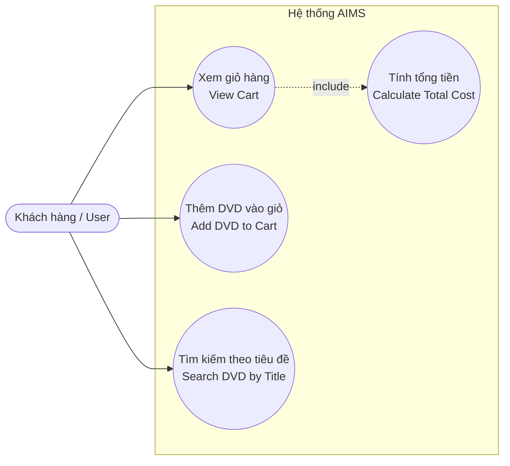

# AIMS Use Case Diagram

Tài liệu mô tả các ca sử dụng (Use Cases) chính trong hệ thống quản lý giỏ hàng AIMS.

## 1. Sơ đồ Use Case

## 2. Mô tả các Use Case chính

* **UC1 - View Cart (Xem giỏ hàng):** Người dùng xem danh sách các đĩa DVD đang có trong giỏ hàng và tổng giá trị đơn hàng.
* **UC2 - Add DVD to Cart (Thêm DVD):** Người dùng thêm một đĩa DVD mới vào giỏ hàng.
* **UC3 - Search DVD by Title (Tìm kiếm theo tiêu đề):** Người dùng nhập từ khóa tiêu đề để lọc danh sách các DVD khớp nội dung trong giỏ hàng.
* **UC4 - Calculate Total Cost (Tính tổng tiền):** Hệ thống tự động tính toán tổng số tiền dựa trên đơn giá của các DVD có trong giỏ hàng.